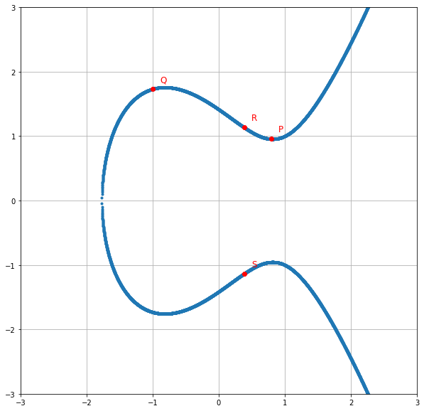
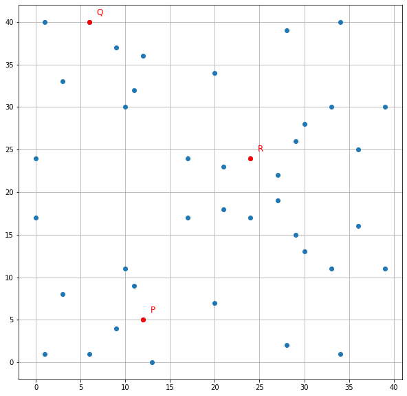

# 🔐 Cryptographie sur courbes elliptiques — ECDSA & ECIES

Implémentation **à la main en Python** de l'arithmétique des courbes elliptiques, de la **signature ECDSA** et du **chiffrement hybride ECIES**, puis comparaison avec les bibliothèques officielles.

> Projet réalisé en binôme : **Selma Douagi** & Thomas Bavoux (décembre 2025)

<p>
  
  
</p>

---

## 🧮 1. Arithmétique des courbes elliptiques
- Courbes `y² = x³ + ax + b` sur ℝ et sur un corps fini 𝔽ₚ
- Addition et doublement de points, point à l'infini
- Multiplication scalaire, inverse modulaire, ordre d'un point
- Énumération optimisée des points avec le symbole de Legendre et **Tonelli-Shanks**
- Visualisation des courbes et des opérations

## ✍️ 2. ECDSA : signature numérique
- **Implémentation from scratch** : génération de clés, signature et vérification avec SHA-256
- **Attaque par force brute** sur une petite courbe : la clé privée est retrouvée en quelques secondes. Cela montre pourquoi les courbes réelles ont environ 2²⁵⁶ clés possibles.
- **Version avec la bibliothèque `ecdsa`** (courbe NIST P-256) : clés au format PEM, signatures DER et brutes

## 📨 3. ECIES : chiffrement hybride
- Clé éphémère et échange **ECDH**, dérivation de clé avec **HKDF-SHA256**, chiffrement authentifié **AES-256-GCM**
- **Scénario Alice / Bob / Charlie** : un message secret glissé dans une transaction publique. Bob le déchiffre ; Charlie, l'espion, échoue.
- **Chiffrement d'un fichier réel** avec la bibliothèque `eciespy`

## 📁 Structure

```
code/
├── ECDSA.ipynb            # Courbes, ECDSA à la main, attaque, bibliothèque officielle
├── ECIES.ipynb            # Chiffrement hybride ECIES
├── courbe_elliptique.py   # Arithmétique sur corps fini
└── fct.py                 # HKDF + AES-GCM
presentation/              # Soutenance (Beamer / LaTeX) + PDF
```

## ▶️ Lancer le projet

```bash
pip install numpy matplotlib ecdsa cryptography eciespy coincurve eth-keys jupyter
cd code
jupyter notebook ECDSA.ipynb
```

> ⚠️ Les implémentations « à la main » ont un but pédagogique. En production, il faut toujours utiliser des bibliothèques cryptographiques auditées.

## 🛠️ Technologies

`Python` · `NumPy` · `Matplotlib` · `ecdsa` · `cryptography` · `eciespy` · `LaTeX / Beamer` · cryptographie asymétrique
